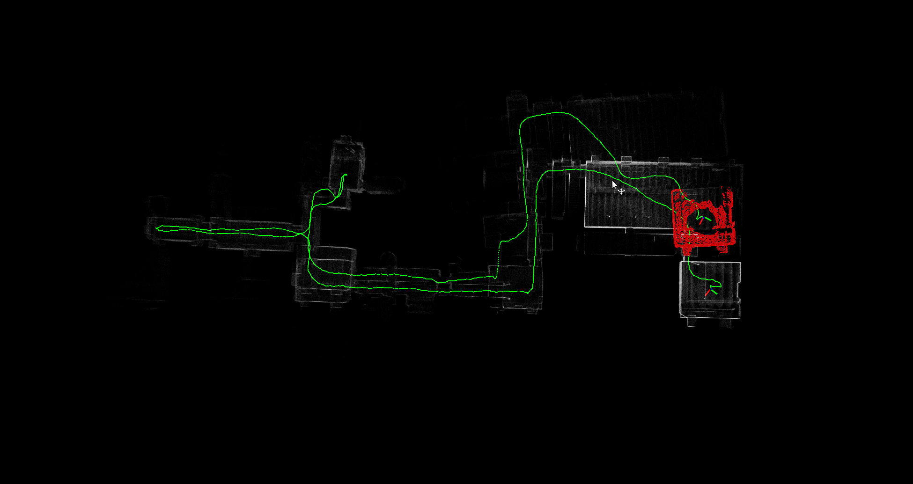
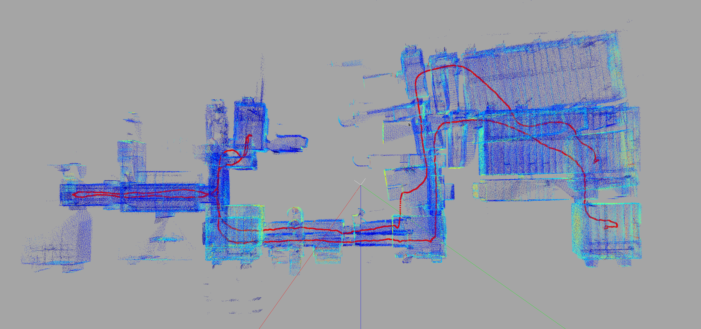
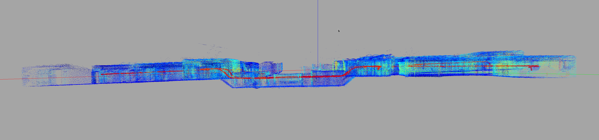

# VINA-SLAM to HDMapping simplified instruction

## Step 1 (prepare data)
Download the dataset `reg-1.bag` by clicking [link](https://cloud.cylab.be/public.php/dav/files/7PgyjbM2CBcakN5/reg-1.bag) or from the [Zenodo](https://zenodo.org/records/23069933) mirror (it is part of [Bunker DVI Dataset](https://charleshamesse.github.io/bunker-dvi-dataset)).

On Zenodo the bag archive is split into `reg-1.zip.part-000`, `reg-1.zip.part-001`, etc.,
download all parts, then merge and extract them:

```bash
cd ~/Downloads
cat reg-1.zip.part-0* > full.zip
zip -F full.zip --out full-fixed.zip
unzip full-fixed.zip
```

File `reg-1.bag` is an input for further calculations.
It should be located in `~/hdmapping-benchmark/data`.

## Step 2 (prepare docker)
```shell
mkdir -p ~/hdmapping-benchmark
cd ~/hdmapping-benchmark
git clone https://github.com/MapsHD/benchmark-VINA-SLAM-to-HDMapping.git --recursive
cd benchmark-VINA-SLAM-to-HDMapping
git checkout Bunker-DVI-Dataset-reg-1
docker build -t vina-slam_humble .
```

## Step 3 (run docker, file `reg-1.bag` should be in `~/hdmapping-benchmark/data`)
```shell
cd ~/hdmapping-benchmark/benchmark-VINA-SLAM-to-HDMapping
chmod +x docker_session_run-ros2-vina-slam.sh
cd ~/hdmapping-benchmark/data
~/hdmapping-benchmark/benchmark-VINA-SLAM-to-HDMapping/docker_session_run-ros2-vina-slam.sh reg-1.bag .
```

The script first converts the LiDAR and IMU topics of `reg-1.bag` to ROS 2.
VINA-SLAM then reads that bag itself, as fast as it processes it, and exits at
the end of the bag. It runs with `mid360_bench.yaml`: VINA-SLAM's `mid360.yaml`
with its local bundle adjustment on (see the README on the main branch).

While VINA-SLAM runs you can watch it build the map live in RViz:



## Step 4 (Open and visualize data)
Expected data should appear in `~/hdmapping-benchmark/data/output_hdmapping-vina-slam`.
Use tool [multi_view_tls_registration_step_2](https://github.com/MapsHD/HDMapping) to open `session.json` from `~/hdmapping-benchmark/data/output_hdmapping-vina-slam`.





You should see the following data in folder `~/hdmapping-benchmark/data/output_hdmapping-vina-slam`:

lio_initial_poses.reg

poses.reg

scan_lio_*.laz

session.json

trajectory_lio_*.csv

## Contact email
januszbedkowski@gmail.com
